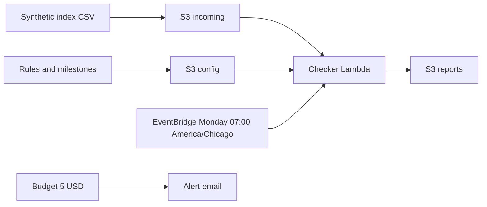

# eTMF Readiness Checker


A serverless check of a synthetic eTMF. It compares an index export with the documents a site should have filed, flags what is missing, expired, still in draft, or filed late, and writes a readiness score. The severity comes from the code. An optional Bedrock classifier is off and cannot file anything.

> **Scope:** This is a portfolio lab, not a validated system and not a production eTMF. The study, sites, investigators, and compound are fictional. `pytest` (17 tests) and `terraform plan` (19 resources to add) were run on 2026-11-09. `terraform apply` was not run, so nothing in this project has been deployed. See [What was run](#what-was-run).

## At a glance

| | |
| --- | --- |
| **Problem** | Before an inspection or a monitoring visit, clinical operations has to know which site documents are missing, still draft, expired, or filed after the site was activated. On a global Phase III study that check is mostly manual. |
| **Solution** | A rule file lists the expected artifacts, the milestone that makes each one due, and whether it expires. A checker compares a synthetic index with that list and writes findings, scores, and a single HTML report. |
| **Environment** | Python 3.12 locally. Terraform `>= 1.6`, AWS provider `~> 5.0` (locked at 5.100.0), region `us-east-1`. State is local. |
| **Proof** | On the fixed date 2026-11-09 the sample study scores 73.8. Six critical findings and four major findings. United States 61.8, United Kingdom 85.2, Japan 74.5. A site with a critical finding scores 49 even when 11 of 12 documents are present. |
| **Hardest problem** | A raw completeness average hides a broken site. The cap is applied to the site first, and the country and study scores average those capped scores. |
| **Cost** | Designed to stay under a $5 monthly budget. No VPC, no NAT gateway, no QuickSight, no always-on compute. Bedrock and CloudTrail data events are off. |
| **Skills shown** | S3 hardening, least-privilege IAM, Lambda, EventBridge Scheduler, CloudWatch retention, AWS Budgets, deterministic checks, and the line between a demo and a GxP system |

## Interview talk track

About 60 seconds, first person.

"At Merck I kept two global Phase III eTMFs inspection-ready across about 360 sites, and the completeness check was mostly manual. I needed the 1572 filed, the CV and the lab certificate still in date, and the IRB approval on file before the site was activated. This project asks those questions in code, on a synthetic 12-site study. An index CSV lands in S3. A Lambda compares it with a DIA TMF Reference Model checklist and writes findings and a readiness score. A critical finding caps that site at 49, so a missing 1572 cannot hide inside a green average. Documents expiring within 60 days are flagged while they are still valid, and a Monday job re-runs the latest index so those dates age on their own. The code decides severity. Bedrock is off, and it cannot file a document. The data is fake, and this is not a validated Part 11 system."

## Contents

- [Architecture](#architecture)
- [How a score is calculated](#how-a-score-is-calculated)
- [Seeded gaps](#seeded-gaps)
- [How to run locally](#how-to-run-locally)
- [How to test](#how-to-test)
- [How to deploy](#how-to-deploy)
- [What was run](#what-was-run)
- [Cost](#cost)
- [Teardown](#teardown)
- [GxP / regulated-environment considerations](#gxp--regulated-environment-considerations)
- [What I would change for production](#what-i-would-change-for-production)
- [Screenshots](#screenshots)
- [Repository layout](#repository-layout)

## Architecture

Zone numbers follow the DIA TMF Reference Model. Central and Local Testing is Zone 08. Zone 09 is Third Parties and is not used here. Form FDA 1572 is required only for United States sites. United Kingdom and Japan sites use an investigator regulatory form instead, so a non-US site is not failed for a US-only form.



One bucket, `p08-etmf-readiness-<account-id>`, with three prefixes:

- `incoming/` holds the eTMF index CSV. An upload of a `.csv` starts the checker.
- `config/` holds the expected-artifact YAML and the milestone calendar. Terraform uploads both.
- `reports/<UTC timestamp>/` holds `findings.csv`, `summary.json`, and `readiness_report.html`. Each run writes a new folder. It does not overwrite the index.

The Lambda is Python 3.12 on arm64, 256 MB, 30 seconds, and it is not in a VPC. EventBridge Scheduler runs it at 07:00 America/Chicago every Monday, lists `incoming/`, and checks the latest CSV. The scheduled run uses the current UTC date, so a document that is valid today can be flagged on a later Monday. The local command and the tests pin `2026-11-09` so the sample does not change underneath the tests.

The checker role can read `incoming/*` and `config/*`, list only those prefixes, and write `reports/*`. A separate scheduler role can invoke that function and nothing else. The HTML report has inline CSS and no JavaScript.

Two switches default to off, and both were absent from the plan:

- `enable_bedrock`. A second Lambda would classify a synthetic PDF with one Bedrock model and write JSON under `reports/classifications/`. Its role cannot write the index. Confidence below 0.8 sets `human_review`. `filed` is always false, set by code.
- `enable_cloudtrail_data_events`. A data-events trail on this bucket, with its own log bucket. Left off because object-level events are billed per request.

## How a score is calculated

An artifact is due when its milestone date is on or before the as-of date and its country filter matches. Close-out on this study is 2027-03-01, so IP return is not due and is not a finding.

A due artifact is satisfied when a `Final` row exists and the document is not expired. A draft does not count. A document expiring within 60 days, including one that expires today, still counts as present and raises a major finding, reason `Expiring Soon`. Expired means the expiry date is before the as-of date. That document is critical and does not count.

| Condition | Severity | Counts as present |
| --- | --- | --- |
| Required artifact has no row | Critical, Missing | No |
| Final document is already expired | Critical, Expired | No |
| Required artifact is still Draft after its milestone | Major, Draft past due | No |
| IRB approval `filed_date` is after site activation | Major, Filed after site activation | Yes |
| Expiry is today through 60 days ahead | Major, Expiring Soon | Yes |

Site completeness is satisfied divided by due. If the site has any critical finding, readiness is the lower of that percentage and 49. Country readiness and study readiness are the unweighted mean of the site readiness scores, so the cap survives the roll-up. Zone completeness stays raw, satisfied divided by due for that zone, with the critical and major counts beside it. Zone 04 can be 100 percent complete and still show the late IRB filing.

On 2026-11-09, site 101 is 11 of 12 and scores 49. Site 103 has the late IRB letter, is 12 of 12, and scores 100. The study score is 73.8.

## Seeded gaps

Study `SYNTH-PH3-001`, compound `EX-100`, protocol `EXAMPLE-001`. Twelve sites, four each in the United States, the United Kingdom, and Japan. Investigators are `Dr. A. Example` through `Dr. L. Example`. Every other due document is Final, filed on 2026-05-20, before activation on 2026-06-01, and the expiring ones run to 2027-06-01.

| Site | What is wrong | Result |
| --- | --- | --- |
| 101 and 104, United States | Form FDA 1572 not in the index | Critical, Missing |
| 102 | PI CV expired 2026-08-01 | Critical, Expired, 100 days overdue |
| 109 | Medical license expired 2026-07-15 | Critical, Expired |
| 111 | Lab certification expired 2026-09-01 | Critical, Expired |
| 107 | Financial disclosure not in the index | Critical, Missing |
| 105 | GCP training certificate still Draft | Major, Draft past due |
| 103 | IRB approval filed 2026-06-15, 14 days after activation | Major, and the site still scores 100 |
| 106 | Lab certification expires 2026-12-01 | Major, Expiring Soon, 22 days |
| 108 | Medical license expires 2027-01-05 | Major, Expiring Soon, 57 days |
| 110 and 112 | Nothing | No findings |

## How to run locally

From this project's directory:

```bash
python3 -m venv .venv
source .venv/bin/activate
pip install -r requirements-dev.txt
python scripts/generate_synthetic_tmf.py
python scripts/run_check.py --as-of 2026-11-09 --out out/
```

Open `out/readiness_report.html` in a browser. The generator is deterministic. Running it again rewrites the same two CSV files.

The local command uses the date in the rule file when you omit `--as-of`. Pass a later date if you want to see a healthy certificate cross into the 60-day window.

## How to test

```bash
source .venv/bin/activate
pytest
```

The tests do not call AWS and do not need boto3. They check that the rule file loads, that Form FDA 1572 is US-only, that every seeded gap is found and nothing else is, that 61 days out is clean and 60 days out is Expiring Soon, that an expired document is critical, that close-out documents stay silent, and that a critical finding caps the site at 49 while the late IRB site is not capped. They also check that the classifier prompt treats the PDF as untrusted data, that the review threshold is 0.8, and that a model response cannot set `filed` to true.

PyYAML is installed for one test: the subset loader must return the same structure as `yaml.safe_load` on this file. The Lambda zip does not contain PyYAML.

## How to deploy

I have not applied this. The commands below are the ones to run.

```bash
cd terraform
cp terraform.tfvars.example terraform.tfvars
```

Edit `budget_alert_email` in `terraform.tfvars`. That file is gitignored.

```bash
terraform init
terraform plan
terraform apply
```

`terraform apply` creates the bucket, uploads the rule file, the milestone calendar, and the sample index, and the index upload invokes the checker. Reports appear under `reports/<timestamp>/`.

To run it again with the same file:

```bash
aws s3 cp ../data/etmf_index.csv s3://<bucket-name>/incoming/etmf_index.csv
```

The bucket name is the `bucket_name` output. A new object under `incoming/` with a `.csv` suffix is enough. The Monday schedule does the same with whatever CSV was uploaded last.

Leave `enable_bedrock` and `enable_cloudtrail_data_events` false unless you mean to turn them on. Bedrock also needs model access in the account, and the model id has to be one the account can invoke. Newer Claude models are often called through an inference profile rather than the foundation-model ARN in `classifier.tf`. Read that ARN before setting the flag.

State is local, in `terraform/`. It is gitignored. A remote backend is a production step, not this demo. `.terraform.lock.hcl` pins the providers and should be committed with the code.

## What was run

On 2026-11-09, from this directory:

- `python scripts/generate_synthetic_tmf.py` wrote the index and the milestone file.
- `pytest` — 17 passed.
- `python scripts/run_check.py --as-of 2026-11-09` wrote the three report files. Study readiness 73.8, 6 critical, 4 major.
- `terraform fmt -recursive`
- `terraform init` and `terraform validate`
- `terraform plan` — 19 to add, 0 to change, 0 to destroy. The plan included the bucket, the checker Lambda, the Monday schedule, the log group, and the $5 budget. It did not include the classifier or the CloudTrail trail.

`terraform apply` was not run. There is no deployed evidence and no screenshot yet.

## Cost

The running path is S3 storage and requests, one small Lambda, one weekly schedule, and a log group that expires at 14 days. That should stay well under $5 if the bucket is not used for anything else.

The budget is named `08-etmf-readiness-checker`, limited to $5 per month, filtered to the tag `Project=08-etmf-readiness-checker`. It emails `budget_alert_email` at 80 percent forecasted and at 100 percent actual. AWS will ask that address to confirm the subscription. The filter sees spend only after `Project` is an active cost allocation tag in Billing. Until then the budget stays at $0 even if something else in the account spends money. The tag is applied by the provider `default_tags` block.

CloudTrail data events and Bedrock are the two ways this demo gets expensive. Both default to false.

## Teardown

From `terraform/`:

```bash
terraform destroy
```

`force_destroy` is true, so destroy deletes the bucket even though versioning is on, including old versions of the index and the reports. The Lambda, the schedule, the log group, and the budget are destroyed with it. Read the destroy plan and confirm the bucket name before you accept it. This bucket is only for the synthetic files in this project.

## GxP / regulated-environment considerations

This demo borrows the questions an inspection asks. It is not a GxP system, and it has not been validated.

**Audit trail.** Versioning is on, so a new upload of the index does not destroy the previous object. Each check writes a new `reports/<timestamp>/` prefix instead of editing an older report. CloudTrail data events would record who called `GetObject` and `PutObject` on the bucket. That switch is off by default and documented in `terraform/cloudtrail.tf`, because object-level events are a per-request charge. Management events for the account are out of scope of this project.

**Access control.** The bucket blocks public access, denies non-TLS requests, and uses SSE-S3. The checker role is limited to the three prefixes it needs. The scheduler role can only invoke the checker. The classifier, when it exists, can read `incoming/pdf/*` and write `reports/classifications/*`. It has no `PutObject` on the index.

**Data integrity, mapped to ALCOA+.**

- Attributable. Every finding names the site, the artifact, and the zone. The milestone file names the investigator. Both are synthetic.
- Legible. The outputs are CSV, JSON, and HTML.
- Contemporaneous. The IRB rule compares `filed_date` with the site activation date. A letter that exists but was filed late is still a finding.
- Original. The uploaded index stays in `incoming/` as a versioned object. Reports are new objects. The checker does not rewrite the index.
- Accurate. Severity, the day count, and the cap are computed. The optional model is not allowed to set them, and it is not allowed to file.
- Complete. The rule file is the expected set. An artifact that is not due yet is not treated as missing.
- Consistent. The same rules and the same date produce the same findings. The generator has no random choices.
- Enduring and available. Objects sit in S3, with a 14-day log retention that is deliberately short for a lab.

**21 CFR Part 11.** A Part 11 system would also need a validated build (IQ, OQ, PQ), a requirement-to-test traceability matrix, authority checks, an audit trail of the regulated record itself, and electronic signatures for actions such as approving a document. This demo has none of those. Uploading a CSV is not an electronic signature. A finding in the HTML report is not a quality decision. Do not put real trial, site, investigator, or patient data in this bucket.

## What I would change for production

- Validate it. Write the user requirements, then IQ, OQ, and PQ, and keep the traceability from each requirement to a test in this repo or to a test that calls the real eTMF.
- Stop using a CSV. Pull the index from the sponsor's eTMF, for example the Veeva Vault API, on a service account with read scope, and write findings back as a report the TMF owner accepts. Do not let this Lambda file documents.
- Put people behind SSO. No long-lived keys for operators. The Lambda role is the right idea for the function. Humans should come in through an identity provider, with a break-glass path that is logged.
- Encrypt with a customer managed KMS key, rotation on, and a key policy that the checker role can use and a person cannot disable without a second approval. SSE-S3 is enough for this lab.
- Split accounts. One for the bucket and the function, one for logs and the trail, and Terraform state in a backend with a lock. `force_destroy` would be false.
- Run CI on the pull request: `pytest`, `terraform fmt -check`, `terraform validate`, and the Checkov scan this repo already runs over `projects/`. Fail the merge on a new public bucket, a missing encryption setting, or a role that can write outside `reports/`.
- Turn CloudTrail data events on in the log account, with a lifecycle policy and an alarm on `DeleteObject`.
- Keep the classifier, if it is used at all, in front of a person. Confidence under 0.8 is a queue, not a filing. The model still does not choose the severity of the readiness check.

## Screenshots

Not added yet. I will drop two images of the local HTML report here after I open `out/readiness_report.html`. No real trial data.

1. `evidence/screenshots/01-site-scores.png` — the study score, the country table, and the per-site bars. The capped sites are the red bars at 49.0.
2. `evidence/screenshots/02-findings.png` — the findings table, including a missing Form FDA 1572 and a lab certification marked Expiring Soon.

## Repository layout

`config/expected_artifacts.yaml` is the checklist a clinical lead can read. Each artifact has a zone, the milestone that makes it due, whether it expires, and, for the 1572 and the non-US investigator form, a country list. The checker does not hardcode that list. Change the file and the next run uses the new rules.

`scripts/generate_synthetic_tmf.py` builds the fake 12-site index and the milestone calendar from that checklist. The gaps are a fixed map in the script, not a random sample, so a second run matches the file the tests already know. It refuses to finish if a gap names an artifact that is not in the rule file.

`data/etmf_index.csv` is the stand-in for an eTMF export. The columns are the study, country, site, zone, artifact, document name, version, effective date, expiry date, status, and filed date. In AWS this object is what you drop in `incoming/`.

`data/site_milestones.csv` is the calendar the index does not carry. Activation, ongoing, and close-out dates tell the checker which artifacts are due. Close-out is in 2027, which is why IP return never becomes a finding in the sample.

`scripts/run_check.py` is the local entry point. It reads the three files, runs the same library the Lambda runs, and writes the three report files under `out/`. Pass `--as-of` when you want a date other than the one in the rule file.

`src/checker/yaml_subset.py` parses this rule file with the standard library. The file only uses mappings, lists, scalars, and comments. That keeps the Lambda zip free of a PyYAML wheel built on a Mac, which would fail on Amazon Linux. A test checks that it matches PyYAML on the committed file.

`src/checker/rules.py` turns that file into the rules the rest of the code uses, and it decides which artifacts apply to a country and which are due on a date. A typo in a milestone name or an unknown key fails here, before any score is calculated.

`src/checker/findings.py` compares the index with the due artifacts. It emits the severity, the reason, the site, the artifact, and either days overdue or days to expiry. Missing and expired are critical. Draft past due, a late IRB filing, and Expiring Soon are major. This module does not call AWS.

`src/checker/scoring.py` rolls those results into site, country, zone, and study scores, and it applies the cap of 49 when a site has a critical finding. Country and study scores average the capped site scores. Zone scores stay raw so you can see that the IRB zone is complete and still has a late filing.

`src/checker/report.py` writes `findings.csv`, `summary.json`, and `readiness_report.html`. The HTML is the page I would open in an interview: the study score, country and zone tables, a bar per site, and the finding list. The CSS is inline. There is no script and no external file. Text from the index is escaped.

`src/checker/handler.py` is the only checker module that imports boto3, and it imports it inside the function so the tests stay local. An S3 upload of a CSV and the Monday schedule both end up in the same library. The upload checks that object. The schedule checks the latest CSV under `incoming/`. Each run writes a new timestamped folder under `reports/`.

`src/classifier/prompt.py` is the optional Bedrock prompt. It tells the model the PDF is untrusted data and to ignore instructions inside the document. `build_classification` sets `human_review` when confidence is missing or below 0.8, and it sets `filed` to false no matter what the model returns.

`src/classifier/handler.py` is the Lambda that would send one synthetic PDF to Bedrock and write the JSON under `reports/classifications/`. Terraform creates it only when `enable_bedrock` is true. The role cannot write the eTMF index, which is the control, not a sentence in the prompt.

`terraform/s3.tf` is the bucket. Public access is blocked, ownership is BucketOwnerEnforced, versioning is on, encryption is SSE-S3, and the bucket policy denies requests that are not TLS. It also uploads the rule file, the milestones, and the sample index.

`terraform/iam.tf` is one role for the checker and one role for the scheduler. The checker is scoped to the prefixes above. The scheduler can invoke the checker and cannot read the bucket.

`terraform/lambda.tf` packages `src/` into the zip and wires the S3 notification for `incoming/*.csv`. The classifier notification is a dynamic block and is empty while Bedrock is off.

`terraform/eventbridge.tf` is the Monday 07:00 America/Chicago schedule. The timezone is set on the schedule, so 07:00 means Chicago time and not UTC.

`terraform/budget.tf` is the $5 monthly budget and the two email notifications. The cost filter is the `Project` tag. The address comes from `budget_alert_email` and is not in git.

`terraform/cloudtrail.tf` is the optional data-events trail and its own log bucket. `count` is zero unless `enable_cloudtrail_data_events` is true. The README section above is the reason it exists and the reason it ships off.

`terraform/classifier.tf` is the optional second Lambda, its log group, and its role. Same pattern: nothing is created while `enable_bedrock` is false. The Bedrock permission is `InvokeModel` on one model ARN.

`tests/test_gaps.py` is the proof that every planted gap is found and that the checker does not invent extras. `test_expiry.py` locks the 60-day boundary and the expired-yesterday case. `test_scoring.py` locks the cap, the late-IRB site that is not capped, and the raw zone score. `test_rules.py` locks the rule file, the US-only 1572, the YAML loader, and the classifier review rule.
